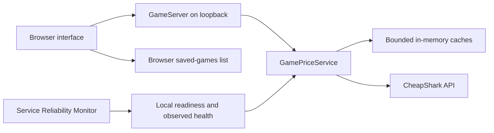

# Architecture

Game Price Search is a local, single-user application. Java serves a browser interface, translates game lookups into read-only CheapShark requests and returns validated results. It does not build a local game catalog or index document contents.

## Components and request flow

- `Main` handles the port, optional browser launch and process lifecycle.
- `GameServer` serves the three web assets and validates HTTP methods, input and the local request boundary.
- `GamePriceService` owns provider requests, JSON validation, store joins, caching and observed provider health.
- `games.js` renders results, filters returned offers and stores up to 50 saved games in browser local storage.

A title search calls `games?title=...&limit=30&exact=0` on the fixed CheapShark API origin. Selecting a numeric game ID loads its details and store metadata. The service joins store IDs to names, excludes inactive stores and sorts offers with `BigDecimal` prices and deterministic ties. Store and maximum-price filters operate on those returned offers in the browser.

Purchase URLs are constructed only for the fixed `https://www.cheapshark.com/redirect?dealID=...` origin. Source deal IDs are decoded, validated and encoded once to avoid changing an already encoded ID. The backend never follows these links; navigation happens only when the user selects an offer.

## Response contract

Search responses include `query`, `currency`, `fetchedAt`, `cached`, `stale`, `warning` and `games`. A game includes `id`, `title`, `steamAppId`, `cheapestPrice` and `dealUrl`. Up to 30 matching titles are returned; this is not a complete catalog or a total-result count.

Detail responses include `id`, `title`, `steamAppId`, `currency`, the same cache fields, nullable `lowestEver` (`price`, `at`) and `offers`. Offers contain `storeId`, `storeName`, `active`, `price`, `retailPrice`, `savings` and `dealUrl`. The historical low comes from CheapShark rather than a locally collected timeline.

All monetary values are USD. The application does not convert currencies, create store accounts, make purchases or schedule price notifications. A saved game contains its ID, title and optional Steam application ID; it does not contain a purchase token or live price subscription.

## Bounded work and caching

| Resource | Bound or policy |
| --- | --- |
| Search input | 1–120 Unicode code points; control characters rejected |
| Search cache | 128 entries, LRU eviction, 15-minute TTL |
| Game-detail cache | 128 entries, LRU eviction, 15-minute TTL |
| Store metadata | 24-hour TTL |
| Upstream response | At most 1 MiB, strict UTF-8 and JSON parsing |
| Upstream connect timeout | Three seconds |
| Each upstream request | Six-second deadline covering the response body |
| Network request starts | At least one second apart within this process |
| Local lookup contention | Wait at most 150 ms for the serialized lookup gate |
| Browser saved-games list | At most 50 entries |

One user lookup may need multiple upstream requests, such as refreshing stores before fetching game details. Its total elapsed time can exceed one request deadline. Provider cooldowns and the one-second request spacing apply to each actual network call, not merely to each browser action.

Caches live only in the Java process. A fresh cache read retains the original `fetchedAt` timestamp. If an expired cached entry exists and refreshing fails, the service can return that entry with `cached=true`, `stale=true` and a warning. A failed refresh never replaces good cached data with empty results. Stale data is useful for browsing previous prices but is not evidence that the provider recovered.

Lookup work is serialized to bound provider traffic. A request that cannot acquire the lookup gate receives HTTP 503 with a short retry hint. This local contention does not count as an upstream failure or change the last observed provider health. This approach suits one interactive user and is not intended for a multi-user hosted service.

## Failure handling and provider observations

Transport errors, invalid provider payloads and non-success responses are surfaced with bounded user-facing messages. A failure starts a cooldown. HTTP 429 honors `Retry-After`, whether expressed as seconds or an HTTP date; invalid/missing values use the default pause. The app does not loop indefinitely or retry automatically in the background.

`GET /api/games/readiness` reports whether the local backend is serving requests. `GET /api/games/health` returns the latest observed provider status, timestamps, counters, cache sizes and remaining cooldown. Neither route contacts CheapShark.

| Observed state | Meaning |
| --- | --- |
| `ready` | No successful price lookup or provider failure has yet been observed in this process. |
| `healthy` | The latest completed uncached price lookup succeeded. |
| `degraded` (HTTP 503) | A provider lookup failed, or the service has closed. |

An uncached successful search or complete game lookup sets `lastSuccessAt`. A failure sets `lastFailureAt` and records the error. Serving fresh or stale cached data does not restore health after an observed failure. An old success does not establish the provider's current availability; timestamps make that limitation explicit.

The companion monitor's `game-price-search.properties` checks local readiness and this observed health snapshot. It can record a backend process outage separately from an observed provider problem. Both targets belong to the same app; the monitor is not measuring two independently deployed services. Its probe schedule never becomes a provider polling schedule.

## Local HTTP and TLS boundaries

The app binds to `127.0.0.1`, validates the request Host and same-origin browser requests, and requires an action header for shutdown. It does not enable cross-origin API access or accept an arbitrary upstream URL. Untrusted provider strings are rendered as text rather than inserted as HTML; purchase links use a fixed origin.

The client uses Java's HTTP/1.1 implementation and does not follow upstream redirects. On Windows, when explicit JVM trust-store properties are absent, it loads the existing `Windows-ROOT` certificates into a TLS context scoped to this client. The portable runtime includes `jdk.crypto.mscapi`. Other operating systems and explicitly configured JVM trust stores use their default configuration. Certificate and hostname validation remain enabled; the app does not change system trust stores.

Only interactive game queries and IDs are sent to CheapShark. The browser's saved-games list remains local until selecting one triggers an ordinary lookup. Runtime price caches are not written to disk.

## Verification boundaries

Unit and local HTTP tests use fake providers to exercise valid and malformed data, active-store joins, ordering, redirect encoding, cache expiry, stale fallback, cooldowns, bounded bodies and response timeouts. These tests are deterministic and do not assert the current public catalog or prices.

The portable-package verifier runs the actual CMD launcher and bundled runtime from an extracted package. The separate monitor integration verifier performs opt-in live lookups, then exercises a real app process outage and recovery using only processes it owns. Public API availability and pricing can change independently of those checks.

See the [CheapShark API documentation](https://apidocs.cheapshark.com/) for the source's request, pricing and linking requirements. The implementation's TTLs and request spacing are local design choices, not a guarantee of a provider quota.
