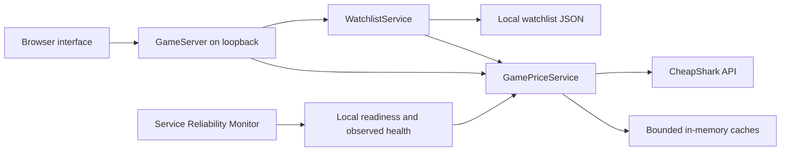

# Architecture

Game Price Search is a local, single-user application. Java serves a browser interface, translates game lookups into read-only CheapShark requests and returns validated results. It does not build a local game catalog or index document contents.

## Components and request flow

- `Main` handles the port, data directory, optional browser launch and process lifecycle.
- `GameServer` serves the three web assets and validates HTTP methods, input and the local request boundary.
- `GamePriceService` owns provider requests, JSON validation, store joins, caching and observed provider health.
- `WatchlistService` owns up to 50 persisted games, optional price targets, periodic checks and in-app alert state.
- `games.js` renders results, filters returned offers and polls the local watchlist snapshot every five seconds. This UI polling does not query CheapShark.

A title search calls `games?title=...&limit=30&exact=0` on the fixed CheapShark API origin. Selecting a numeric game ID loads its details and store metadata. The service joins store IDs to names, excludes inactive stores and sorts offers with `BigDecimal` prices and deterministic ties. Store and maximum-price filters operate on those returned offers in the browser.

Purchase URLs are constructed only for the fixed `https://www.cheapshark.com/redirect?dealID=...` origin. Source deal IDs are decoded, validated and encoded once to avoid changing an already encoded ID. The backend never follows these links; navigation happens only when the user selects an offer.

## Response contract

Search responses include `query`, `currency`, `fetchedAt`, `cached`, `stale`, `warning` and `games`. A game includes `id`, `title`, `steamAppId`, `cheapestPrice` and `dealUrl`. Up to 30 matching titles are returned; this is not a complete catalog or a total-result count.

Detail responses include `id`, `title`, `steamAppId`, `currency`, the same cache fields, nullable `lowestEver` (`price`, `at`) and `offers`. Offers contain `storeId`, `storeName`, `active`, `price`, `retailPrice`, `savings` and `dealUrl`. The historical low comes from CheapShark rather than a locally collected timeline.

All monetary values are USD. The application does not convert currencies, create store accounts or make purchases. A watchlist item can have no price target, or a target from 0 to 1,000,000 USD with at most two decimal places. A successful price observation at or below that target can raise an in-app notification. There are no email, operating-system or push notifications.

## Persistent watchlist and price checks

The watchlist lives in `watchlist.json` under `%LOCALAPPDATA%/GamePriceSearch` on Windows, falling back to the user's home directory at `.game-price-search`. The `--data-dir` option selects a separate directory, including for isolated development and test runs. Persistence belongs to that directory rather than to a browser or port. It is local to this computer and does not sync to an account.

The service holds a file lock for the selected directory, so two processes cannot write the same watchlist. Each change is serialized to a temporary file in that directory and flushed before replacement. The replacement uses an atomic move where the filesystem supports it, with a regular replacement fallback. New in-memory state is published only after the file has been replaced successfully. Invalid or oversized existing state is rejected rather than silently overwritten. The JSON file is capped at 512 KiB and 50 items.

While the application is running, a single background worker checks saved games at 30-minute intervals. An existing nonempty list is checked when the app starts; the user can also request a check. Only one refresh cycle can run at a time, and repeated requests do not queue more cycles. The worker uses the same provider client, caches, request spacing and cooldowns as interactive lookups. Therefore a recently fetched price can be reused without treating the check time as a new price observation.

Each item records the last check time separately from the original successful quote time in `lastSuccessAt`, which comes from the detail response's `fetchedAt`. Failed or stale refreshes keep known prices and their observation times visible with an error and do not raise new price alerts. Acknowledging an alert is persisted. Another successful observation still below the target does not re-create an acknowledged alert; a later observed price above the target followed by a drop back to it can create a new alert. Changing a target resets its evaluation for a subsequent eligible observation.

Closing a browser tab leaves this local worker running. Selecting **Quit app** stops the process and its checks. When the app is closed, no refreshes or notifications occur. Opening the UI again shows persisted unread alerts. An explicit import action can copy saved games from the previous version's browser local storage; that old list is not silently read as the new persistent list.

## Bounded work and caching

| Resource | Bound or policy |
| --- | --- |
| Search input | 1–120 Unicode code points; control characters rejected |
| Search cache | 128 entries, LRU eviction, 15-minute TTL |
| Game-detail cache | 128 entries, LRU eviction, 15-minute TTL |
| Store metadata | 24-hour TTL |
| Upstream response | At most 1 MiB, strict UTF-8 and JSON parsing |
| Upstream connect timeout | Three seconds |
| Each upstream request | Six-second deadline covering the response body |
| Network request starts | At least one second apart within this process |
| Local lookup contention | Wait at most 150 ms for the serialized lookup gate |
| Persistent watchlist | At most 50 entries and 512 KiB of JSON |
| Watchlist refresh | Every 30 minutes while the app runs; one active cycle |
| UI watchlist polling | Every five seconds; local snapshot only |

One user lookup may need multiple upstream requests, such as refreshing stores before fetching game details. Its total elapsed time can exceed one request deadline. Provider cooldowns and the one-second request spacing apply to each actual network call, not merely to each browser action.

Caches live only in the Java process. A fresh cache read retains the original `fetchedAt` timestamp. If an expired cached entry exists and refreshing fails, the service can return that entry with `cached=true`, `stale=true` and a warning. A failed refresh never replaces good cached data with empty results. Stale data is useful for browsing previous prices but is not evidence that the provider recovered.

Lookup work is serialized to bound provider traffic. A request that cannot acquire the lookup gate receives HTTP 503 with a short retry hint. This local contention does not count as an upstream failure or change the last observed provider health. This approach suits one interactive user and is not intended for a multi-user hosted service.

## Failure handling and provider observations

Transport errors, invalid provider payloads and non-success responses are surfaced with bounded user-facing messages. A failure starts a cooldown. HTTP 429 honors `Retry-After`, whether expressed as seconds or an HTTP date; invalid/missing values use the default pause. The client does not loop indefinitely or retry a failing request immediately. A later requested or scheduled watchlist cycle may try again through the same cooldown checks.

`GET /api/games/readiness` reports whether the local backend is serving requests. `GET /api/games/health` returns the latest observed provider status, timestamps, counters, cache sizes and remaining cooldown. Neither route contacts CheapShark.

| Observed state | Meaning |
| --- | --- |
| `ready` | No successful price lookup or provider failure has yet been observed in this process. |
| `healthy` | The latest completed uncached price lookup succeeded. |
| `degraded` (HTTP 503) | A provider lookup failed, or the service has closed. |

An uncached successful search or complete game lookup sets `lastSuccessAt`. A failure sets `lastFailureAt` and records the error. Serving fresh or stale cached data does not restore health after an observed failure. An old success does not establish the provider's current availability; timestamps make that limitation explicit.

The companion monitor's `game-price-search.properties` checks local readiness and this observed health snapshot. It can record a backend process outage separately from an observed provider problem. Both targets belong to the same app; the monitor is not measuring two independently deployed services. Its probe schedule never becomes a provider polling schedule.

## Local HTTP and TLS boundaries

The app binds to `127.0.0.1`, validates the request Host and same-origin browser requests, and requires an action header for shutdown and watchlist mutations. It does not enable cross-origin API access or accept an arbitrary upstream URL. Untrusted provider strings are rendered as text rather than inserted as HTML; purchase links use a fixed origin.

The client uses Java's HTTP/1.1 implementation and does not follow upstream redirects. On Windows, when explicit JVM trust-store properties are absent, it loads the existing `Windows-ROOT` certificates into a TLS context scoped to this client. The portable runtime includes `jdk.crypto.mscapi`. Other operating systems and explicitly configured JVM trust stores use their default configuration. Certificate and hostname validation remain enabled; the app does not change system trust stores.

Interactive game queries and IDs, plus IDs selected for watchlist refreshes, are sent to CheapShark. Price targets, notification acknowledgments and the watchlist file remain local. General runtime price caches are not written to disk; the watchlist persists only its bounded per-game observations and alert state.

## Verification boundaries

Unit and local HTTP tests use fake providers to exercise valid and malformed data, active-store joins, ordering, redirect encoding, cache expiry, stale fallback, cooldowns, bounded bodies and response timeouts. Watchlist tests use temporary data directories and a supplied clock and lookup to exercise persistence, input limits, refresh behavior and alert transitions. These tests are deterministic and do not assert the current public catalog or prices.

The portable-package verifier runs the actual CMD launcher and bundled runtime from an extracted package. The separate monitor integration verifier performs opt-in live lookups, then exercises a real app process outage and recovery using only processes it owns. Public API availability and pricing can change independently of those checks.

See the [CheapShark API documentation](https://apidocs.cheapshark.com/) for the source's request, pricing and linking requirements. The implementation's TTLs and request spacing are local design choices, not a guarantee of a provider quota.
