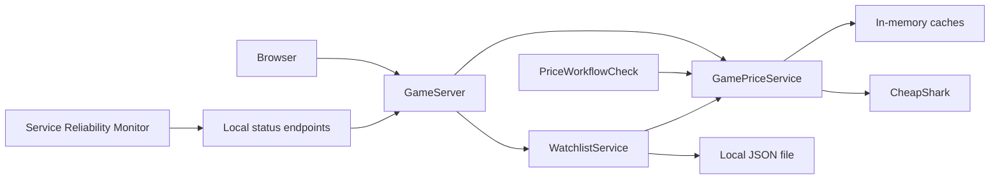

# Architecture

Game Price Search runs as a local Java server with a browser interface. The backend calls CheapShark for catalogue and price data; the browser calls only the local backend.

## Components

| Component | Responsibility |
| --- | --- |
| `Main` | Startup options, port selection, data directory and shutdown. |
| `GameServer` | Local HTTP routes, input checks and static pages. |
| `GamePriceService` | Provider calls, response validation, store joins, caches and provider health. |
| `WatchlistService` | Saved games, price targets, refreshes and alert state. |
| `PriceWorkflowCheck` | Scheduled validation of a fresh search and its store offers. |
| `games.js` / `deals.js` | Search, discovery, store comparison and watchlist controls. |

## Search and discovery

A title search returns catalogue matches. Selecting a numeric game ID fetches its offers and joins store IDs to active store names. Prices use `BigDecimal` for exact comparison.

Discovery fetches one provider page of up to 30 store offers. Budget and store filters are enforced locally as well as requested upstream. This matters because CheapShark treats `upperPrice=50` as unlimited. The minimum-discount control filters only the loaded page. A full raw page supplies a next-page hint, even if local filtering removes its offers.

Purchase links use CheapShark's fixed redirect origin and are opened only by the user. Visiting **Compare & watch** loads game details without changing saved targets.

## Provider failures and caching

Searches, game details and discovery pages each have a 128-entry LRU cache with a 15-minute TTL. Store metadata is cached for 24 hours. If a refresh fails, an available older response retains its original timestamp and displays a warning.

Provider requests share a serial gate, start at least one second apart and have a six-second deadline. Responses are limited to 1 MiB. HTTP 429 respects `Retry-After`; other failures also start a cooldown. These limits keep the local app from sending bursts or waiting indefinitely on the provider.

## Watchlist storage

The watchlist stores up to 50 games in a local JSON file, capped at 512 KiB. A directory lock prevents two app processes from writing the same file. Changes are written through a temporary file and replaced atomically where supported; memory is updated only after a successful save.

A single worker refreshes saved games every 30 minutes while the app runs. It uses the same provider client and caches. Fresh eligible prices can raise target-hit alerts; failed or stale observations retain the last known price without creating new alerts. Acknowledgements survive restarts. A later price rise and drop can create another alert.

## Health signals

| Endpoint | Meaning |
| --- | --- |
| `/api/games/readiness` | The local server responds. |
| `/api/games/health` | The last provider lookup was unverified (`ready`), successful (`healthy`) or failed (`degraded`). |
| `/api/games/workflow` | A recent fresh Portal search and matching store offers passed validation. |

Workflow checking is opt-in with `--workflow-check`, runs on startup and every 15 minutes, and expires after 20 minutes. A failed or expired check returns HTTP 503. Reading these reports does not query CheapShark. All three signals describe the same application process.

## Local boundaries

The server binds to `127.0.0.1`, validates Host/Origin and requires an action header for mutations. Provider text is rendered through DOM text nodes. TLS certificate and hostname checks remain enabled; the Windows client can use native trusted roots.

Search terms and selected game IDs are sent to CheapShark. Saved price targets and acknowledgements remain local. The application has no cloud account, multi-user hosting or checks after shutdown.

See [Testing](validation.md) for automated, integration and package checks.
